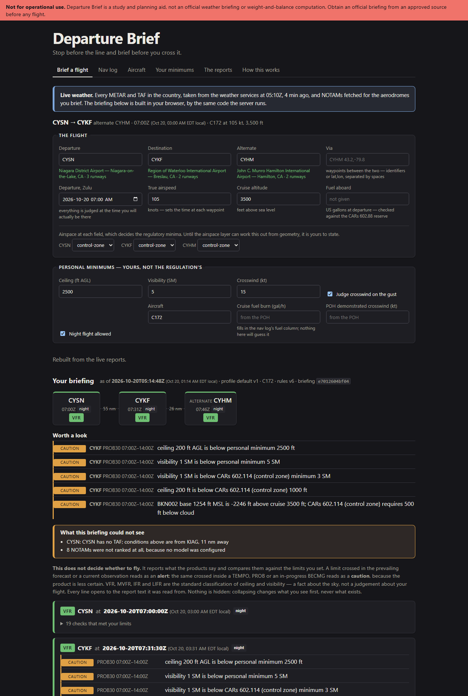
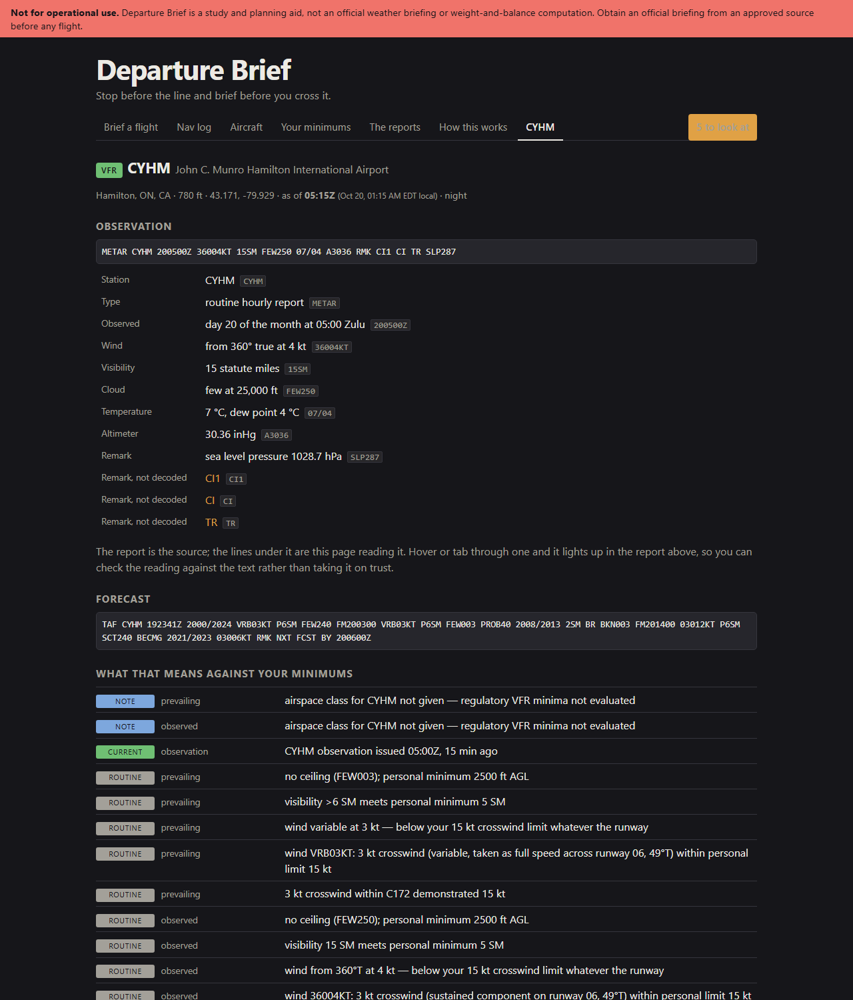
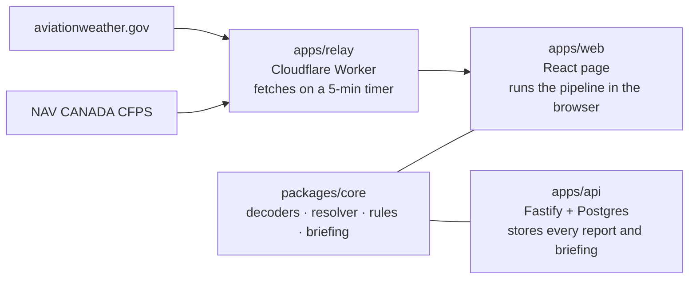

# Departure Brief

[](https://github.com/nberkyilmaz/departure-brief/actions/workflows/ci.yml)

A pre-flight briefing tool for VFR pilots. It decodes the raw aviation weather
and NOTAMs, works out which forecast applies at each point of the route at
the time you will actually be there, and checks it all against your own
personal minimums and the regulations — with every line citing the exact
characters of the report it came from.

**[Open the live site →](https://nberkyilmaz.com/departure-brief/)**
The whole pipeline runs in your browser, over live weather for every
aeroplane field in Canada and the United States — 17,647 of them.

> **Not for operational use.** This is a study and planning aid, not an
> official weather briefing. It does not decide whether to fly — that is the
> pilot's call. Always get an official briefing from an approved source.



## Why I built it

I fly a Cessna 172 out of St. Catharines (CYSN). Before every flight I read
the same dozen products — METARs, TAFs, NOTAMs, upper winds, SIGMETs — and
relate them in my head: *this* forecast, at the time I will be *there*,
against the limits *I* set. Existing apps are excellent at fetching and
displaying, and leave that relating to the pilot. This does the relating,
and shows its working.

## What it does

- **Decodes** METAR, TAF, NOTAM, SIGMET/AIRMET and upper-wind reports with
  hand-written, span-annotated parsers: every decoded value knows which
  characters of the report it came from. Under 0.3 % of tokens go unparsed
  across a corpus of 8,000 real reports.
- **Resolves the route in time**: ETA at each waypoint, the TAF period that
  governs each one (prevailing versus TEMPO/PROB overlays), the nearest
  reporting station when a field has closed for the night.
- **Checks** each point against personal minimums, Canadian VFR minima
  (CARs 602.114/115), US minima (FAR 91.155), crosswind per runway, daylight,
  fuel reserve (CARs 602.88), hazard areas crossing the route, and the
  temperature at cruise.
- **Works the nav log**: the wind triangle leg by leg, from upper winds
  interpolated to the cruising altitude.
- **Ranks NOTAMs** for the flight: deterministic rules where there is one
  right answer, an optional local model for the rest, gated by an
  evaluation harness that fails the build.
- **Diffs briefings**: what changed since you last looked, measured against
  your limits rather than the text.
- **Reads weight and balance out of a scanned 1976 handbook** with OCR, and
  only uses a figure once it has been found on the page.



## How it fits together



- **`packages/core`** is the pipeline, with no UI assumptions: decoders,
  the route/time resolver, the rules engine, briefing assembly and diff, the
  nav log, NOTAM ranking and the document reader. Its `judge` entry point
  is free of Node dependencies, and a test bundles it for the browser to
  prove it.
- **`apps/web`** runs that same code in the page, so changing a minimum
  rebuilds the briefing instantly — and produces a briefing with the same
  content hash the server would.
- **`apps/relay`** exists because neither weather service allows a browser to
  call it directly. It takes the whole continent's reports on a timer and
  keeps the latest copy, so visitors never multiply requests to the
  services. It runs on Cloudflare's free plan and holds no weather logic.
- **The aerodromes** travel as an index the page loads up front (300 KB)
  and two-degree squares of full records it fetches only when a question
  touches one. The store answers exactly as one holding all of them would,
  and a test holds it to that.
- **`apps/api`** is the full server: every raw report stored verbatim and
  content-addressed, briefings immutable and reproducible, forecast
  verification over time.

More on the decisions behind this, and the trade-offs, in
**[DESIGN.md](DESIGN.md)**.

## Engineering notes

- **Deterministic first.** No model anywhere near the decoders or the rules;
  a METAR has exactly one correct parse. The two optional model uses are
  local (Ollama) and measured.
- **Nothing is hidden.** Ranking changes order and what is collapsed, never
  what exists. A model error degrades to noise, never to a missing NOTAM.
- **Every finding cites its source**, down to the span within the report.
- **Zulu internally**, local time only at the display edge.
- **Reproducible.** Raw reports are append-only and content-addressed, so
  what was known at any moment can be reconstructed exactly.
- **Tested on real data.** About 900 tests, run in CI on Node 20 and 22
  against a real Postgres, all replaying recorded upstream responses — no
  test touches the network, and no fixture is invented.

## Measured, not estimated

**NOTAM relevance** — qwen2.5:7b against a reviewed labelled set of 31 real
NOTAMs for the demo flight: 85.7 % agreement, 100 % recall on the critical
ones, no unverifiable citations. Disagreements are all over-warning. A
closed runway at your departure aerodrome is settled by a rule from the Q
code, not by the model.

**Handbook extraction** — qwen2.5vl:3b reading a scanned 1976 POH: 28
figures proposed, 6 verified against the page and used (6 of 6 correct), 22
sent to a review queue. Precision is a hard gate because these go into a
weight-and-balance sum; recall is reported and deliberately not gated.

## Running it

Requires Node 20+. Docker is only needed for the Postgres-backed API.

```bash
npm install
npm test                  # the whole suite; Postgres tests run when the database is up
npm run typecheck

# The page, with live weather through a local relay:
npm run dev -w apps/relay
VITE_DEMO=1 VITE_RELAY=http://127.0.0.1:8787 npm run dev -w apps/web

# The CLI:
npm run depbrief -- decode "METAR CYSN 191800Z 24008KT 15SM FEW040 18/09 A3002"
npm run depbrief -- brief flights/demo-cysn-cykf.json --fetch
npm run depbrief -- notams flights/demo-cysn-cykf.json --fetch

# The API and Postgres:
cp .env.example .env      # put a contact address in DEPBRIEF_USER_AGENT
npm run db:up && npm run build -w apps/web && npm start
```

Deploying the relay and the API is covered in **[docs/deploy.md](docs/deploy.md)**;
what comes next is in **[docs/roadmap.md](docs/roadmap.md)**.

**Stack:** TypeScript throughout · React + Vite · Fastify · Postgres/PostGIS ·
Cloudflare Workers + KV · Vitest · GitHub Actions · pdf.js + Tesseract for
OCR · Ollama for the optional local models.

## Data sources

All public, with no redistribution restrictions:

- [aviationweather.gov](https://aviationweather.gov/) (NOAA/AWC) — METAR, TAF, SIGMET/AIRMET
- NAV CANADA CFPS — Canadian NOTAMs and upper winds (the endpoint behind plan.navcanada.ca; unofficial, so the client fails loudly if its shape changes)
- FAA NASR — US airports, runways, magnetic variation
- OurAirports — airports and runways; the public site's whole set of Canadian and American fields (public domain)

Requests carry a real `User-Agent`, and nothing fetched is committed.
